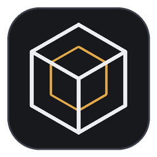
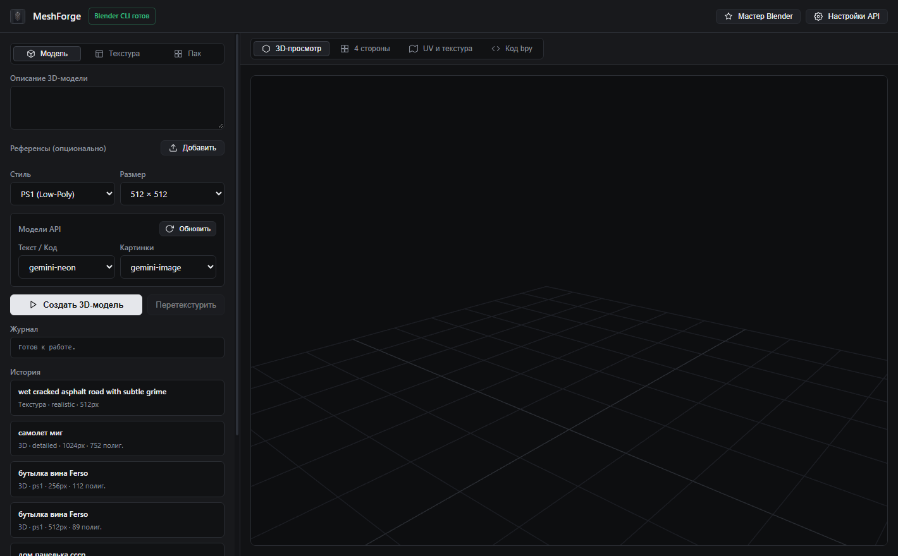
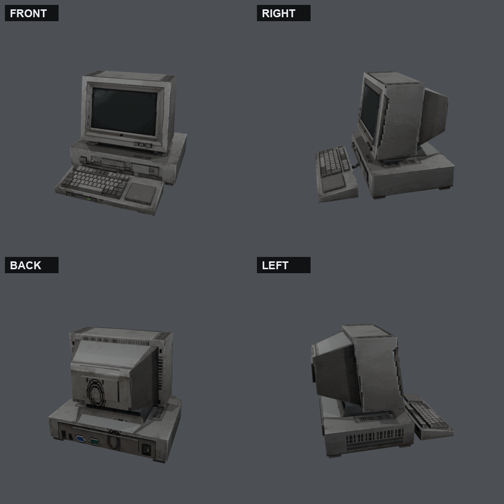
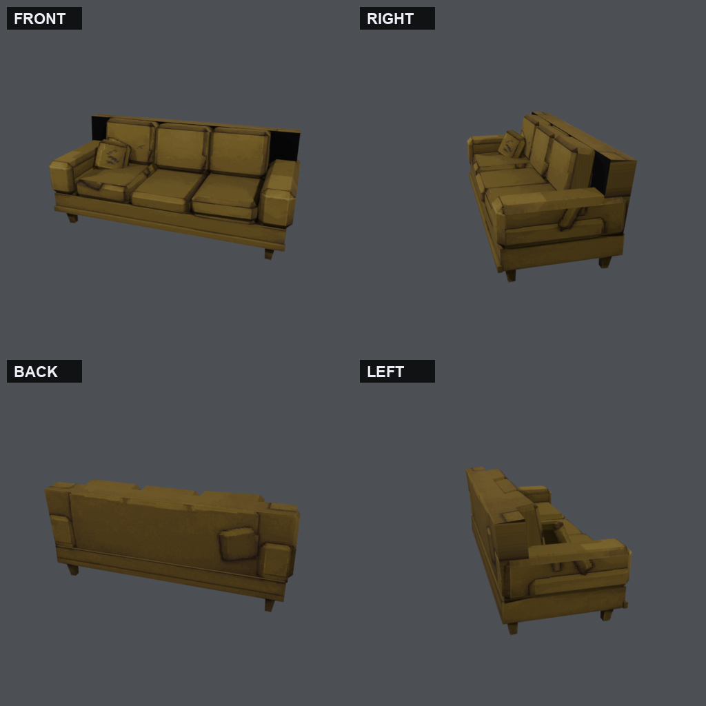
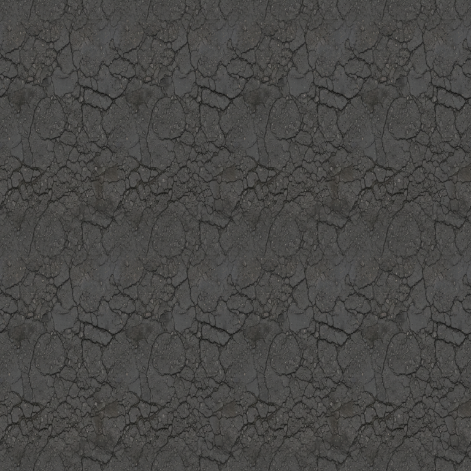
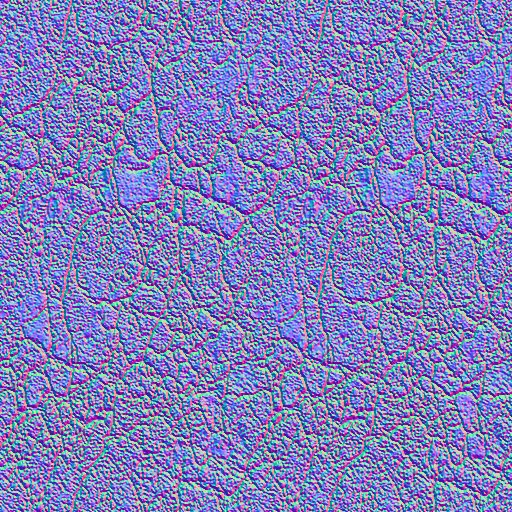

<div align="center">
  
  <h1>MeshForge</h1>
  <p>Windows-приложение (Python + WebView + Blender CLI) и Agent CLI для генерации 3D-моделей, бесшовных текстур и PBR-паков через любой OpenAI-совместимый API.</p>
</div>

<p align="center">
  
</p>

## Возможности

### 1. Генератор 3D-моделей (`Модель`)
- **2-шаговый пайплайн с прогрессивным показом:**
  1. Текстовая модель генерирует `bpy`-скрипт геометрии и структурированный текстурный гайд по зонам. При ошибке Blender стектрейс автоматически отправляется обратно на исправление (до 3 попыток).
  2. Сразу после сборки меша он появляется в интерактивном 3D-просмотре (`stage1_preview.glb`), пока генерируется текстура.
- **2×2 семантический UV-атлас:** автоматически раскладывает полигоны в 4 предсказуемые зоны (`FRONT`, `TOP_PANEL`, `SIDES`, `BACK_BASE`) и передаёт генератору картинок 3 карты (`uv_guide.png`, `uv_3d_preview.png`, `uv_template_clean.png`), чтобы стороны модели не путались.
- **Стили:** `PS1 (Low-Poly)`, `Стилизованный`, `Реализм (PBR)`, `Воксель / Пиксель`, `Хоррор / Индастриал`.
- **Выход:** `.glb` со встроенными текстурами, `texture.png`, `uv_guide.png`, `preview_4side.png` (рендер с 4 сторон) и исходный код `generated_model.py`.

<p align="center">
  
  
</p>

### 2. Генератор текстур и PBR-карт (`Текстура`)
- **Бесшовный тайлинг:** тороидальное смещение с косинусным сглаживанием швов (`tiled_2x2.png`) + интерактивный 3D-просмотр материала на сфере, кубе или плоскости.
- **Генерация PBR-карт:** `Normal Map` (Sobel), `Roughness Map`, `Height / Displacement`, `Ambient Occlusion`, `Metallic`.
- **ИИ-улучшайзер:** расширяет короткий запрос в точный материал-промпт и автоматически подбирает параметры генератора карт (`normal_strength`, `roughness_base`, `ao_strength`, `height_contrast`).

<p align="center">
  
  
</p>

### 3. Генератор паков текстур (`Пак`)
- Текстовая модель разбирает общий запрос (например, *«пак текстур для дороги»*) на согласованный набор поверхностей, генерирует каждую текстуру, делает бесшовной и строит PBR-карты в папку пака.

### 4. Гибкое подключение API и Мастер Blender
- Поддержка **любого OpenAI-совместимого API** (`/v1/chat/completions`, `/v1/images/generations`, `/v1/models`) с раздельным выбором модели текста и модели генерации изображений прямо в интерфейсе.
- Встроенный **Мастер Blender** при первом запуске ищет `blender.exe` (Steam, реестр Windows, PATH, Blender Foundation, WinGet) либо предлагает установить Python-модуль `bpy`.

---

## Установка и запуск

```bash
pip install -r requirements.txt
python app.py
# или на Windows:
run.bat
```

## CLI для ИИ-агентов (`forge_cli.py`)

Все команды выводят структурированный JSON в `stdout`:

```bash
# Список доступных моделей из API
python forge_cli.py models

# Генерация 3D-модели (.glb + 4-стороннее превью)
python forge_cli.py model "retro industrial radio" --style ps1 --size 512 --out ./export_radio

# Бесшовная PBR-текстура с ИИ-улучшайзером и картами
python forge_cli.py texture "wet cracked asphalt" --style realistic --size 512 --seamless --enhance --maps normal,roughness,ao,height

# Генерация пака текстур
python forge_cli.py pack "industrial bunker surfaces" --count 4 --style realistic --size 512 --seamless --maps normal,roughness,ao
```

## Структура проекта

```text
├── app.py                   # Локальный HTTP-сервер и окно pywebview
├── forge_cli.py             # CLI-утилита с JSON-выводом для агентов
├── backend/
│   ├── config.py            # Настройки, стили и поиск Blender/Steam
│   ├── llm_client.py        # Клиент OpenAI-совместимых API
│   ├── blender_bridge.py    # Запуск Blender CLI / bpy и подготовка UV-гайдов
│   ├── uv_guide_lib.py      # 2x2 семантическая UV-развёртка и экспорт GLB
│   ├── bpy_runner.py        # Изолированный раннер внутри Blender
│   ├── pbr_tools.py         # Бесшовный тайлинг и расчёт PBR-карт
│   ├── model_pipeline.py    # Пайплайн 3D-моделей
│   └── texture_pipeline.py  # Пайплайн одиночных текстур и паков
├── ui/
│   ├── index.html           # Интерфейс приложения
│   ├── styles.css           # Графитовый минимализм и кастомные скроллбары
│   ├── viewer3d.js          # Three.js GLB + PBR-просмотрщик
│   └── app.js               # Логика режимов и задач
└── assets/                  # Иконка приложения и примеры рендеров
```
